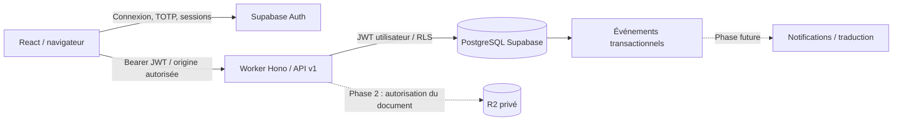

# Architecture — phase 1

## Choix

Monorepo npm, TypeScript strict, React 19/Vite, React Router, TanStack Query, i18next et Tailwind 4. Composants sémantiques natifs (labels, formulaires, boutons, navigation, retours d’erreur), thème persistant et adaptation mobile. Hono s’exécute sur Cloudflare Workers. Zod partage les contrats de saisie. Supabase fournit Auth et PostgreSQL, et non le stockage documentaire. Aucun projet existant n’est réutilisé.

Le navigateur utilise directement Supabase **uniquement pour Auth** ; les opérations métier passent par `/api/v1`. Le Worker transmet le JWT utilisateur avec une clé publique. Il n’utilise jamais de clé `service_role` : RLS et RPC assurent aussi la protection contre un accès direct à PostgREST. Les transactions de mutation et leurs événements d’audit sont atomiques dans PostgreSQL.

## Modules et frontières

`client.ts` gère le transport ; les contrats métier sont partagés. L’API gère la session, l’origine, le quota, les erreurs et les RPC. Les autorisations décisives vivent dans les fonctions SQL et les policies RLS ; aucune visibilité frontend n’est une autorisation. `storage.ts` expose une interface minimale de lecture/suppression et son adaptateur R2, sans route de fichier tant que les permissions documentaires ne sont pas implémentées.

La journalisation serveur contient un identifiant de requête et une classe d’erreur, sans contenu documentaire, jeton ou SQL. L’audit métier conserve acteur/action/ressource/organisation ; l’outbox ajoute un identifiant d’idempotence. Les futurs consommateurs devront enregistrer `(consumer,event_id)` dans une contrainte unique **dans la transaction de consommation**, puis gérer l’idempotence du fournisseur de notification.

## Services requis

Un nouveau Supabase (Auth, PostgreSQL, courriel de confirmation et TOTP) pour les fonctions réelles. R2 ne sera requis qu’en phase 2. Les transformations PDF devront s’exécuter dans un service isolé avec délais, plafonds mémoire/CPU, réseau fermé et fichiers temporaires nettoyés. Aucun parseur CAO serveur.

## Risques et décisions

L’accès Supabase depuis la Chine doit être testé avant choix de région. Examiner résidence des données, contrats de sous-traitance, sauvegardes, latence, disponibilité SMTP et obligations de confidentialité. Les sessions SPA sont stockées par le SDK : une faille XSS resterait critique ; CSP stricte et absence de HTML injecté réduisent ce risque. Une architecture BFF à cookies HttpOnly peut être évaluée avant généralisation.

L’intégration réelle Auth/SMTP, les contrôles du navigateur authentifié et le déploiement ne sont pas validés par les tests à mocks. Aucun provisioning cloud, achat, envoi métier externe ou déploiement automatique. Voir DEPLOYMENT.md.

## Variante frontend Vercel

Le frontend statique utilise `VITE_API_BASE_URL` pour appeler directement le Worker. Le CORS du Worker autorise uniquement `APP_ORIGIN` (pas de wildcard Vercel) et le contrôle des mutations reste actif. Le développement local conserve son proxy Vite. Voir [VERCEL.md](VERCEL.md) pour les variables et la configuration du monorepo.
