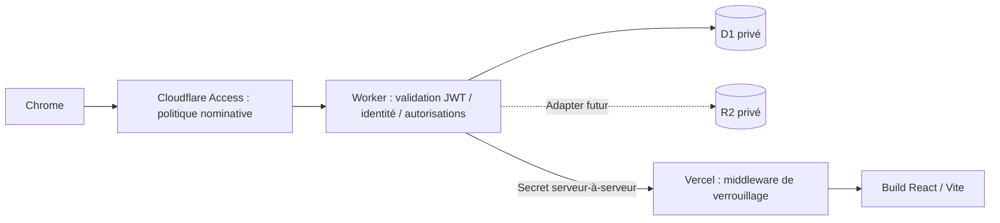

# Architecture D1 / R2 / Access

## Flux privé unique

Le navigateur ne visite pas directement Vercel : il passe par le domaine privé de la passerelle Worker. API et assets partagent cette origine, évitant les cookies Access tiers et les redirections CORS de connexion. Vercel compile le workspace `apps/web` depuis la racine et le middleware racine exige un secret serveur partagé. La passerelle ne transfère ni JWT ni cookie Access à Vercel. Les redirects d’origine sont refusés ; utiliser l’hôte HTTPS canonique.

## Modules

- `apps/api/src/identity.ts` : `IdentityProvider`, validation Access via jose, JWKS distant à URL configurée et cache/rotation. Pas de clé codée en dur, d’algorithme JWT choisi par le client ou d’identité dans Vite.
- `types.ts` : `Identity` externe et `Principal` métier séparés ; erreurs HTTP contrôlées et bindings.
- `database.ts` : association identité réelle/profil et `Store` D1. Prédicats paramétrés `orgScope` et `projectScope`, mutations/audit/outbox en `D1.batch`.
- `index.ts` : API `/api/v1`, validations Zod, limite de corps, CORS exact, origine des mutations, rate limiter et erreurs sans SQL/token.
- `gateway.ts` : frontend Vercel après autorisation, clé d’origine injectée côté serveur, pas de cache public ni redirection de secrets.
- `middleware.ts` : verrou de tous les chemins Vercel, y compris assets et SPA ; refuse si le secret est absent.
- `storage.ts` : interface d’objets R2 scoped par organisation/projet/document, clés aléatoires, intégrité/quarantaine. Pas de route activée.
- `apps/web` : apparence React existante, TanStack Query, Router, Tailwind, i18next et préférences de compte D1. Aucune authentification intégrée à ForgeBridge.

## Identité temporaire et futurs comptes

Seuls les JWT applicatifs signés par le domaine Access configuré, portant l’AUD exact et le courriel administrateur configuré sont admis. Le vrai `sub` est lié dans `identity_links` à `ADMIN_USER_ID` (UUID généré une seule fois, non secret). Une autre identité ne reçoit pas les droits du propriétaire même si un navigateur fournit un en-tête d’utilisateur. Un changement de sujet Access exige une reliaison administrateur explicite, pas une substitution automatique.

L’abstraction d’identité et les tables d’appartenances permettront d’ajouter un vrai fournisseur d’identité plus tard. Le serveur n’active actuellement aucun compte fournisseur. Les permissions futures sont déjà testées au niveau de la couche D1 avec des fixtures isolées. Ne pas réactiver les invitations avant d’intégrer et tester ce futur fournisseur.

## Données et événements

UUID produits par `crypto.randomUUID()`, timestamps ISO UTC, booléens INTEGER, rôles/états par CHECK, intégrité par clés étrangères composites et index. Pas de RLS SQLite : la base n’est accessible que par binding au Worker ; les conditions de portée sont incluses dans les requêtes. Les validations de mutation sont répétées dans les statements de la transaction, pas seulement avant la transaction.

L’audit est append-only par triggers. Chaque mutation métier ajoute un événement et une outbox atomiquement. L’outbox réserve une clé d’idempotence unique ; le futur consommateur devra aussi garder une contrainte `(consumer,event_id)` et utiliser l’idempotence du service d’envoi. Aucun consommateur externe n’est lancé.

## Coûts et risques

Architecture simple pour environ six utilisateurs : JWT/JWKS mis en cache, listes plafonnées à 200 lignes et indexées, pas de PDF/CAO serveur ni de notification en boucle. Les actifs passent par le Worker et le middleware Vercel, ce qui génère des requêtes ; estimer ces volumes avant activation des fichiers. Vérifier les quotas gratuits réels et les éventuelles demandes de moyen de paiement avant création ; aucune gratuité universelle n’est promise.

La disponibilité et la latence depuis la Chine, la région et la confidentialité contractuelle restent à valider. Aucune preuve locale ne remplace les tests des politiques Access et du middleware sur le déploiement distant.
